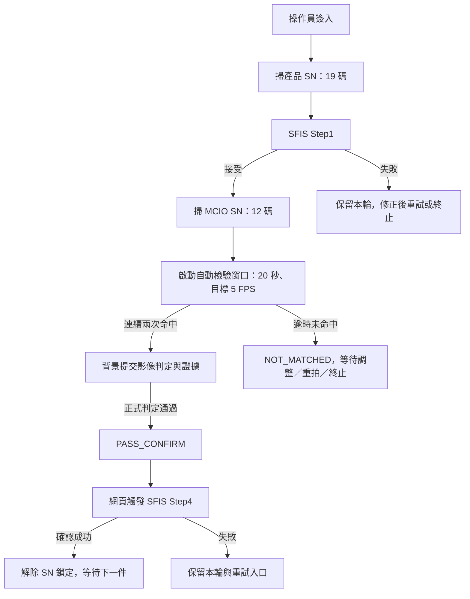

# APL_1109 版本閱讀與新增功能整理

閱讀範圍提醒：以下是 `main@199972c` 修改前的盤點。2026-11-09 已在本機完成 Capture／取像分離，原文「同步自動比對」等描述屬於基底版本；目前修改與驗證結果見[實作紀錄](APL_CAPTURE_STREAM_ISOLATION_IMPLEMENTATION_20261109_ZH.md)。

整理日期：2026-11-09（Asia/Taipei）。本文件依本機實際程式、設定、Git 歷史及 PC 測試整理，不代表產線已安裝或實機驗收通過。

## 1. 這版主要增加什麼

此版最明確的新功能為 **PATLITE LR5-LAN 三色燈控制**及**產品／MCIO SN 固定長度檢查**。原有單張影像判定、SFIS Step1／Step4、相機釋放與重開恢復仍保留。

需特別區分：此版不是先前 `APL_fail/nk_apl_v5` 的 10/15 串流優化分支繼續往後更新。它沒有完整包含該分支的背景模板探測、3 FPS、狀態提示穩定化及詳細診斷功能。目前自動比對仍同步執行於相機 runtime 主迴圈，設定為 5 FPS。

| 項目 | 本次確認結果 |
|---|---|
| 閱讀目錄 | `D:\work_project\smartcam\NK_APL\APL_1109\nk_apl_v5` |
| Git 分支 | `main`，追蹤 `origin/main` |
| HEAD | `199972c824cea33d37b75d11291b33af242dc92c` |
| HEAD 日期／訊息 | 2026-11-06，`this version is 1105 prd version` |
| 先前對照版本 | `D:\work_project\smartcam\APL_fail\nk_apl_v5`，`feature/apl-production-stream-optimization`，`1703439` |
| 兩者共同祖先 | `61233513f06b6d08c5dcbee4e0c0f10d616f5ae2` |
| 閱讀前工作目錄 | 乾淨，沒有未提交修改 |

`APL_1109` 是本機資料夾名稱；提交訊息稱此內容為 1105 產線版。兩者不能代替板端部署路徑、版本雜湊及運行紀錄。

## 2. 目前的程式結構與操作流程



- `visionedge_server.py`：網頁／API、站點命令、相機生命週期及 WHEP 代理整合。
- `apl_station.py`：工號、兩段掃碼、SFIS 契約、檢驗與證據狀態機。
- `apl_matching.py`：固定尺寸、固定搜尋 ROI 的模板比對。
- `edge_runtime.py`：相機取像、預覽、疊圖、自動檢驗排程及燈號事件。
- `camera_worker.py`／`camera_lifecycle.py`／`camera_recovery.py`：QTI worker、停止／回收、異常重開條件。
- 新增 `light_tower.py`：PATLITE PNS 封包與背景 TCP 傳送。
- `static/apl_ui.js`：站點操作、狀態顯示、WebRTC、符合條件時的自動 Step4。

Step4 的自動觸發在網頁 `maybeAutoStep4()`；不能把它描述成無須網頁即可由後端自行完成的過帳工作。每個 cycle 自動嘗試一次，失敗後顯示重試。

## 3. 新增：PATLITE 三色燈整合

來源：`light_tower.py`、`edge_runtime.py` 的 `_light_tower_tick()`、`apl_station.py` 設定驗證，以及 [三色燈設計](plan/LIGHT_TOWER_SCHEMA_20261019_ZH.md)。

### 3.1 目前設定

```json
"light_tower": {
  "enabled": false,
  "host": "192.168.10.1",
  "port": 10000,
  "timeout_sec": 1.0
}
```

**程式已加入，隨附設定仍是停用。** 不能因為有 `light_tower.py` 就認定實體燈已在運作。

使用 PNS TCP binary protocol，預設 TCP 10000；這個實作不透過警報燈的 HTTP 設定頁，也不是既有 ZLAN Modbus 繼電器控制。

### 3.2 狀態與燈號

| 事件 | 程式觸發條件 | 隨附設定的燈號 |
|---|---|---|
| `camera_on` | 相機迴圈運行，其他事件不符合 | 綠燈慢閃 |
| `auto_capture_start` | 自動檢驗已啟動的 `WAITING_CAPTURE`，或 `JUDGING` | 黃燈慢閃 |
| `judge_timeout` | `NOT_MATCHED` 且本 cycle 的自動檢驗窗口已逾時 | 紅燈快閃 |
| `judge_pass` | `PASS_CONFIRM` 或 `UPLOADING` | 綠燈恆亮 |
| 關閉／清除 | runtime 結束時 best-effort 發送 `C` | 全燈熄、蜂鳴停止 |

手動拍照失敗、`RECOVERY_REQUIRED`、SFIS 失敗沒有獨立紅燈事件；依目前選擇函式會落入其他適用事件或 `camera_on`。綠閃不代表 SFIS 一定可達，綠恆亮也不代表 Step4 已過帳；它可能仍在等待／執行上傳。Step4 完成回到待機後，會轉回綠閃。

### 3.3 傳送設計與限制

- 相機迴圈的 `request()` 只更新想要的狀態，socket 由 `patlite-tower` 背景執行緒持有。
- 相同狀態不重複傳送；忙碌期間以最新狀態為準，不累積全部歷史事件。
- 發送 `S` 動作控制或 `C` 清除封包，檢查 ACK／NAK。錯誤記錄 warning，失敗後約 2 秒再試；既有 socket 失效時先嘗試重新連線。
- 閃爍由燈本體執行，程式不用不斷切換 ON／OFF。
- runtime status 增加 `light_tower`，包括 `enabled`、`host`、`port`、`connected`、`event`、`error`。
- `connected`／`event` 表示最近一次指令回覆與已送事件，沒有週期性 `G` 狀態讀回或心跳；狀態不變時，斷線可能要到下次送指令才發現。
- 清除燈號是有限等待、盡力而為；程序被強制終止、斷電或網路不可達時，不能保證實體燈已熄。
- 本功能不建立 `eth1`、不配置 USB 網卡或路由；燈號服務可達性仍依裝置的網路設定。

## 4. 新增：SN 固定長度檢查

`apl_station.py` 新增 `_validated_length()`、`_serial_length()`、`_wrong_length_error()`，並於產品／MCIO 收碼時驗證。

| 設定 | 本版值 | 行為 |
|---|---:|---|
| `sn_length` | 19 | 產品 SN 必須剛好 19 個字元 |
| `mcio_sn_length` | 12 | MCIO SN 必須剛好 12 個字元 |
| `sn_prefix` | 空字串 | 未強制產品 SN 前綴 |
| `mcio_sn_prefix` | 空字串 | 未強制 MCIO SN 前綴 |

- 設為 `0` 或未設定時，不做精確長度限制；原有最大長度限制仍存在。
- 僅 snapshot 模式使用精確長度規則，與既有前綴規則相同。
- 前綴先檢查，再檢查長度；設定本身不是整數、超界或使用布林值會被拒絕。
- 產品 SN 長度不符時不建立新 cycle、不送 Step1；MCIO 長度不符時保留產品與等待 MCIO 的狀態。
- 站點 status 增加 `sn_length`、`mcio_sn_length`。錯誤訊息包含要求長度與掃入長度，沿用現有錯誤顯示。

根目錄 README 仍寫「產品必須 K2V5 開頭、MCIO 必須 APL 開頭」，但實際 JSON 兩個前綴皆為空。**本版實際限制是長度，不是 README 所述的強制前綴。**

## 5. 自動檢驗的真實執行方式

目前 `auto_capture` 為 `enabled=true`、`fps=5.0`、`required_hits=2`、`timeout_sec=20.0`、`timeout_action=not_matched`。

自動檢驗並非本版首次出現；這次要注意的是現有排程和先前優化分支不同：

1. `_run()` 取得並發布影像後，呼叫 `_auto_capture_tick()`。
2. `_auto_capture_tick()` 直接呼叫 `station.matcher.evaluate_snapshot(frame)`，在相機 runtime thread 內等待它完成。
3. 連續兩次命中或逾時後，才由 `_start_auto_commit()` 建立 `apl-auto-capture` 背景執行緒。
4. 背景工作呼叫 `inspect_frame()`／`inspect_snapshot()`，重新執行正式比對並保存原圖、結果圖、JSON 與資料庫紀錄。

**背景執行的是結果提交／證據階段；持續的模板探測沒有移出取像迴圈。** PATLITE 另有自己的網路執行緒，兩者也不能混為一談。

保留的機制包括：窗口在自動探測真正啟動時開始；未命中不持續寫證據；逾時提交一次後暫停該 cycle；手動重拍可重新啟動窗口；比對例外被捕捉並記錄，不直接拋出整個相機迴圈。

5 FPS 是排程目標，每次只有約 200 ms 的週期，沒有證明 SmartCam 每張能在此時間內完成。逾時檢查也沒有先前分支的 probe 完成時間核對，因此 20 秒不是嚴格的整個工作完成上限。這些是待驗證項目，不能只由版本名稱宣告效能已改善或一定會崩潰。

## 6. 與 10/15 優化版的差異

對照基準為 `APL_fail/nk_apl_v5@1703439`，以下是本機內容比較，不是兩台設備的實測差異。

| 項目 | 10/15 優化版 | APL_1109 現況 |
|---|---|---|
| 自動檢驗頻率 | 3 FPS | 5 FPS |
| 模板探測 | 單一背景 probe，不排隊 | 同步於相機 runtime 主迴圈 |
| 結果提交／證據 | 背景提交 | 保留背景提交 |
| 舊結果防護 | 有 `expected_cycle_id`／`expected_attempt_count`，probe key 含 camera generation | 這兩個提交參數及 probe 機制未帶入；仍保留檢驗開始後的 cycle／generation／取消檢查 |
| snapshot 預覽 | 可避開比對用的 `frame_lock` | `process_frame()` 仍先進入 `frame_lock` |
| 灰階前處理 | 先裁 ROI 再轉灰階 | 先整張轉灰階再裁 ROI |
| 黃色連線提示 | 保留最後有效站點顯示，連續兩次 API 失敗才警告 | 未包含 `stationConnectedOnce`／失敗次數緩衝，單次錯誤可回到 API ERROR／連線警告 |
| WebRTC 顯示 | 解碼仍前進時可容忍短暫狀態延遲 | 顯示仍要求 API 新鮮及 `frame_seq` 前進；API 過舊時 stream key 變空並關閉既有連線 |
| 狀態快照資訊 | stale reason、age、節流 warning／恢復紀錄 | 保留 `status_stale`，未帶入原因／年齡與 episode 紀錄 |
| 診斷工具 | `apl_diagnostics.py`、收集器、彙整器、瀏覽器遙測 | 本目錄無這些檔案／對應診斷 API |
| MediaMTX | 有 1 MiB UDP 接收緩衝設定及 service 範本 | YAML 無 `udpReadBufferSize`，本目錄無 `mediamtx.service` 範本 |

這表示先前處理過的「狀態延遲就閃黃色提示／畫面被隱藏或重建」條件在此版仍存在。這是程式風險與版本差異，**沒有本次實機紀錄可證明它已在產線重新發生**。

詳細診斷未帶入不等於完全沒有 log：相機生命週期、SFIS trace／前端 SFIS console，以及新 PATLITE warning 仍有各自的紀錄。

## 7. 相機與 Golden Sample 是否有新增

- `camera_worker.py`、`camera_lifecycle.py`、`camera_recovery.py` 與對照版本 SHA-256 相同。EOS／NULL、worker 回收、異常重開條件不是此版新加入。
- `barcode_reader.py`、`scanner_selection.py`、`inspection_store.py`、`workflow_view.py` 亦與對照版本 SHA-256 相同。
- `templates/` 全部 **20 張，7 類**，逐檔 SHA-256 與對照版本相同：目標「50 關蓋有卡」8 張，其餘 6 類各 2 張。
- `apl_matching.py` 仍遍歷全部 7 類的模板；尚未實作只計算單張判定必要 3 類的減量方案。
- 尚未加入前面討論的角度估計、定位點、旋轉補償、有限角度搜尋或相機位移偵測。
- 相機設定仍為 QTI、camera 0、1920×1080、30/1、rotation 0、headless；`infer_fps=10` 和 `auto_capture.fps=5` 是兩個不同設定。
- 檢驗規則仍為搜尋 ROI `[751,254,431,588]`、`TM_CCOEFF_NORMED`、門檻 0.8、兩個反例分差至少 0.05。

相機 worker 的 H.264／RTP 分支與 Python 檢驗工作分開，因此同步比對的負載不能直接等同 MediaMTX 故障；但它會延後 runtime 下一輪取像／狀態發布，仍需一起量測。

## 8. 啟動及產線設定需注意的內容

| 設定／檔案 | 目前內容 | 意義 |
|---|---|---|
| Web 服務 | HTTPS `0.0.0.0:8765`，12 threads | `config/edge.ini` 的預設 |
| TLS 檔案 | `config/certs/CRS0000000616.cert`、`.key` | 本機目錄未提供；TLS 開啟卻缺檔會拒絕啟動 |
| SFIS JSON | `mode=http`、`bypass_sfis=false`、`step4_enabled=true` | 無環境覆寫時走真實 Step1／Step4 |
| SFIS URL | `http://10.0.28.125:8097/api/SFISAPI` | 出站使用 HTTP；與操作網頁的 HTTPS 分開 |
| 站別 | `line=TEST`、`station=V5_AI-CAM` | 是否符合正式站點須由 SFIS 負責人確認 |
| `visionedge-apl.service` | `Environment=APL_DMZ_MODE=disabled` | 覆寫 JSON，呼叫 SFIS 時會報 DMZ disabled，不是自動 PASS |
| service／啟動腳本路徑 | `/var/rootdirs/opt/VisionEdge_APL` | 不會自動使用與 PC 同名的 `APL_1109` 目錄 |
| `run_apl.sh` | 直接 exec Python | 未包含舊優化版對 TLS／DMZ／bypass 的啟動前強制檢查 |
| Browser Video Test | `video_test_enabled=true` | 工程影片入口開啟，與對照版本的 false 不同 |
| MediaMTX WHEP | TCP 8889，代理目標 `127.0.0.1` | 應用與 YAML 相符 |
| MediaMTX ICE/TCP | TCP 5000 | 仍需檢查 gstd 或其他服務是否占用 |
| RTP | `127.0.0.1:5004/UDP`、`smartcam` | 相機送入 MediaMTX 的裝置內部串流 |
| 公告媒體位址 | `webrtcAdditionalHosts: [192.168.50.212]` | 沒有列先前產線 `.183`／直連 `.130`；實際 ICE 還可能包含自動偵測的介面位址，須核對板端設定／候選，不可直接斷言一定不能連 |

因此「手動執行 Python」與「照隨附 service 啟動」可能有不同的 SFIS 行為。以上內容是現況記錄，本次沒有修改設定、安裝 unit 或重啟任何設備。

## 9. 現有文件尚未同步的地方

| 現有文件敘述 | 本次由程式確認的現況 |
|---|---|
| README 表示 SFIS bypass=true、Step4=false | JSON 為 bypass=false、Step4=true；service 又覆寫 mode=disabled |
| README 表示只有按 Capture 才檢驗 | JSON 啟用 20 秒自動檢驗 |
| README 表示必須 K2V5／APL 前綴 | JSON 前綴為空，新增加的是 19／12 碼長度 |
| `HANDOVER_ZH.md` 指向 cowork_2／10 月初分支 | 本目錄為 main@199972c |
| `APL_DEVELOPMENT_VERSION.txt` 指向 9 月舊來源與 92 項測試 | 已不適合表示本目錄版本；本次測試結果見下一節 |
| 燈號設計文件泛稱拍照失敗亮紅／重置全熄 | 實作的紅燈只對自動窗口逾時；一般 cycle 結束回待機綠閃，runtime 關閉才盡力清除 |

本次保留這些歷史內容，透過此文件明確指出差異；未把未驗證的部署狀態改寫成已驗收。

## 10. 本次 PC 驗證

主要驗證使用現有 `C:\Users\NUKO\miniforge3\envs\torch_sister\python.exe`：Python 3.12.5、OpenCV 4.11.0、NumPy 1.26.3、Flask 3.1.0。未安裝或變更套件。

```powershell
cd D:\work_project\smartcam\NK_APL\APL_1109\nk_apl_v5
& 'C:\Users\NUKO\miniforge3\envs\torch_sister\python.exe' -B -m unittest discover -s tests -p 'test_*.py' -q
node --check static/apl_ui.js
```

| 檢查 | 結果 |
|---|---|
| 維護中測試總數 | 357 |
| 通過 | 351 |
| 失敗 | 1 |
| 錯誤 | 1 |
| 跳過 | 4，缺少參考影片 |
| PATLITE／SN 長度相關測試 | 通過，使用本機模擬 TCP 對端及假的站點 transport |
| `node --check static/apl_ui.js` | 通過，僅語法檢查 |

未通過的兩項：

1. `test_matching.MatchingTests.test_all_seven_classes_have_two_samples`：測試仍要求每類恰好兩張，與目標類實際八張不符。不能據此認定模板載入或相機失效。
2. `test_video_temperature.InputTests.test_live_cycle_can_switch_to_browser_video_without_resetting_sn`：在 `after['dmz']['bypass']` 發生 `KeyError: 'bypass'`。目前 JSON 不 bypass，測試模式 profile 走 `BROWSER TEST - SFIS DISABLED`，不提供該鍵；測試仍預期 BYPASS 行為。這是測試與設定契約不一致，尚未修改。

初步亦在既有 `amr_pol_ocr` 執行，同樣為上述兩項未通過；其 OpenCV 4.6.0 低於專案宣告的 >=4.8，故以符合該版本下限的 `torch_sister` 再核對，採後者結果為主要紀錄。`ml_env` 未提供 Flask，因此未在其中安裝依賴或啟動應用。

測試中的相機釋放失敗、timeout、PATLITE NAK 等 log 包含故意注入的錯誤案例，不能當成此次有真實 SmartCam 故障。

本次未連線 SmartCam、未送真實 SFIS、未操作實體燈、未跑現場瀏覽器或重新量測板端比對時間。PC 單元測試不能證明相機／WebRTC 長時間運行、PATLITE 網路接線及實際過帳成功。

## 11. 後續應優先確認的項目

1. 上線前先統一 JSON 與 service 的 SFIS 模式，確認部署目錄、TLS 憑證及實際網卡位址；不要只看根目錄 README。
2. 若要保留先前的串流穩定性改善，應另行整合背景模板探測、工作量限制與不因短暫 API 延遲拆線的 UI；本次僅辨識差異，未做移植。
3. 開啟 PATLITE 前，確認板端到 `192.168.10.1:10000` 的路由／接線，並確認紅燈、綠燈所代表的業務語意符合現場需求。
4. 修正兩項過時測試假設及文件矛盾，再在 SmartCam 驗證 20 秒連續未命中、PASS 後過帳、重拍、停止／重開、多人觀看與燈斷線。
5. 角度容忍／定位補償仍是獨立待實作事項；此版沒有更換 Golden，也沒有加入旋轉補償。

## 12. 主要程式閱讀位置

| 檔案 | 位置／用途 |
|---|---|
| [light_tower.py](../light_tower.py) | `validated_light_tower()`；第 101 行 `select_event()`；第 117 行 `PatliteTower`；第 209 行 ACK／NAK 交換 |
| [apl_station.py](../apl_station.py) | 第 145 行長度驗證；第 662／699 行收碼檢查；第 928 行預覽；第 972 行正式檢驗 |
| [edge_runtime.py](../edge_runtime.py) | 第 2174 行主迴圈呼叫；第 2418 行燈號；第 2526／2562 行同步探測；第 2584 行背景提交 |
| [apl_matching.py](../apl_matching.py) | 第 41 行 ROI；第 83 行全類別模板迴圈；第 123 行單張判定 |
| [visionedge_server.py](../visionedge_server.py) | 第 145 行狀態快照；TLS／port preflight 及站點 API |
| [static/apl_ui.js](../static/apl_ui.js) | 第 244 行狀態新鮮度；第 318 行連線提示；第 637 行自動 Step4；第 788／850 行串流條件 |
| [config/apl_workflow.json](../config/apl_workflow.json) | SN、auto_capture、PATLITE、SFIS 的隨附值 |
| [config/edge.ini](../config/edge.ini) | QTI、HTTPS、相機／影像參數、WHEP、影片測試開關 |
| [visionedge-apl.service](../visionedge-apl.service) | 部署路徑與 DMZ 環境覆寫 |
| [mediamtx.yml](../mediamtx.yml) | 公告 IP、ICE/TCP、RTP 來源 |

本次僅新增本文件並更新文件索引；上述行號對應閱讀時的 `199972c` 程式內容。
